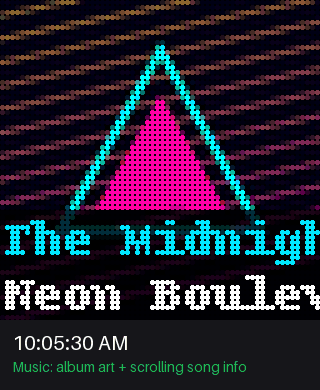
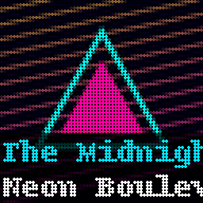
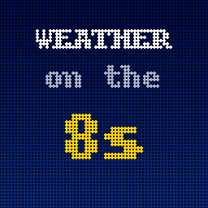
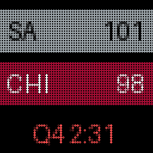
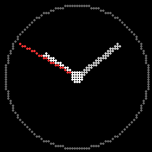
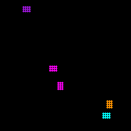
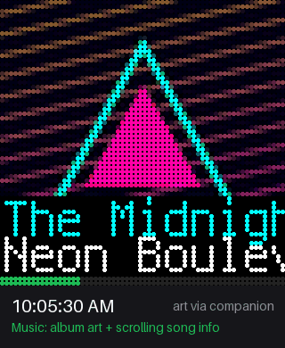

# Raspberry Pi Spotify LED Matrix Display

Turn a 64×64 RGB LED panel into a little always-on display for your desk or wall:
album art for whatever's playing on Spotify, a clock, weather, live sports scores, a
retro "Weather on the 8s" forecast and a couple of screensavers. It runs entirely on a
Raspberry Pi — or an Adafruit **Matrix Portal** — on your own network, no Home Assistant
or cloud service needed.


## What it's like to have one

<p align="center">
  
</p>

*A simulated morning, rendered from the app's real display code (album covers and band
names are made up). The panel switches on its own: album art while music plays, the
clock when it stops, a local forecast every ten minutes, and whatever you pick from your
phone in between.*

## Gallery

Each mode on its own, looping (also rendered from the real display code):

| Music | Weather on the 8s | Live sports |
|:---:|:---:|:---:|
|  |  |  |
| Long names scroll, then reset | The full sequence, sped up (2.5 s per screen) | Score and game clock, then records |
| **Clock** | **Pipes** | **DVD logo** |
|  |  |  |
| Analog or digital | Windows-style 3D pipes | Watch for the corner hit (counter bottom-right) |

## Features

- 🎵 **Album art** for the current Spotify track, tuned for LEDs (contrast/saturation),
  with the **song and artist** along the bottom — long names scroll. Turn the text off
  for art only.
- 🔀 **Switches by itself**: album art when music starts, the clock when it stops,
  time-based schedules. A mode you pick by hand stays until music starts again.
- 📺 **Weather on the 8s**: a Weather Channel-style local forecast at :08, :18, :28, :38,
  :48 and :58 (current conditions, details, next hours, 3-day), then back to what was on.
- 🌤️ **Weather**: current temperature and conditions (OpenWeatherMap, free key).
- 🏈 **Live sports**: your team's score, game clock and records from ESPN — NFL, NBA,
  WNBA, MLB, NHL, MLS, college football and basketball. No API key.
- 🕐 **Clock**: analog or digital, 12- or 24-hour.
- 🔧📀 **Screensavers**: Windows-style 3D Pipes and the bouncing DVD logo (with the
  corner-hit rainbow).
- 📱 **Web dashboard** on your network: switch modes, brightness, test pattern, now playing.
- 🔐 **Admin panel**: every setting in a proper form (or raw JSON), applied live — no restarts.

## Two ways to build it

| | Raspberry Pi + RGB Matrix Bonnet | Adafruit Matrix Portal S3 / M4 |
|---|---|---|
| Runs | Python on Linux | CircuitPython firmware (`matrix-portal/`) |
| Setup | `install.sh` | Copy files to the board |
| Web dashboard / admin | On the Pi | On the [companion](companion/) (any always-on computer — a Pi works) |
| Album art | ✅ | ✅ with the companion; ✅ standalone on the S3 |
| Everything else above | ✅ | ✅ (Weather mode, Weather on the 8s, sports, clock, screensavers) |
| Soldering | E jumper for 64×64 | None |

The rest of this page covers the Pi. For the Matrix Portal see
[below](#matrix-portal-version) and **[docs/MATRIX_PORTAL_SETUP.md](docs/MATRIX_PORTAL_SETUP.md)**.

## Hardware

| Part | Notes | ~Cost |
|---|---|---|
| Raspberry Pi Zero 2 W (or Pi 3/4) | Pi Zero 2 W is plenty | $15 |
| [Adafruit RGB Matrix Bonnet](https://www.adafruit.com/product/3211) | Plugs onto the Pi — no wiring. Or wire a generic HUB75 adapter ([guide](docs/WIRING.md)) | $15 |
| 64×64 HUB75 LED panel | P3 or P2.5 pitch for indoors | $25–40 |
| 5V 4–5A power supply | Powers the panel (not through the Pi) | $15 |
| microSD card, 16 GB+ | | $8 |

> **64×64 panels on the Bonnet need one solder blob:** bridge the Bonnet's **E** pad to
> **8**. Without it only half the panel lights up. See [docs/WIRING.md](docs/WIRING.md).

## Quick start

New to Raspberry Pi? Follow **[docs/PI_SETUP_GUIDE.md](docs/PI_SETUP_GUIDE.md)** from
flashing the SD card onwards. Short version, on Raspberry Pi OS (Bookworm or newer):

```bash
git clone https://github.com/ctrimm/rpi-zero-pixel-album-art.git
cd rpi-zero-pixel-album-art
sudo bash install.sh                     # dependencies, LED library, virtualenv, service
nano config.json                         # add your Spotify Client ID + secret
venv/bin/python src/spotify_auth.py      # sign in to Spotify (as yourself, not sudo)
sudo systemctl enable --now spotify-display
```

Spotify credentials come from the [Spotify Developer Dashboard](https://developer.spotify.com/dashboard):
create an app and add the redirect URI `http://127.0.0.1:8888/callback`. On a Pi without a
screen, `spotify_auth.py` prints a link — open it on your phone, sign in, and paste the
address you land on back into the terminal.

Then open **`http://<your-pi>:5000`** for the dashboard and **`/admin`** for settings
(login `admin` / `changeme` — change it there; the panel reminds you).

To watch the logs instead of running it as a service: `sudo venv/bin/python src/main.py`.

## Settings

Everything is editable in the admin panel, which saves to `config.json` and applies
changes immediately (LED hardware settings need a restart). The highlights:

| Where | Setting |
|---|---|
| General | Brightness, default mode, auto-switching, clock style, song & artist on/off |
| Spotify | Client ID/secret, how often to check for skips |
| Weather | OpenWeatherMap key and location, Weather on the 8s |
| Sports | League, team, refresh rate |
| Hardware | Adapter board (`adafruit-hat` for the Bonnet), panel size, GPIO slowdown, colour order |
| Security | Admin username/password |

`config.example.json` documents every key if you prefer editing the file.

## Display modes

**Music** — album art for the current track; artist (cyan) and song (white) on a dark
band along the bottom, scrolling when they don't fit.

**Weather on the 8s** — at :08, :18, :28, :38, :48 and :58 it takes over for ~46 seconds:
intro, current conditions with today's high/low, humidity/wind/visibility, two "next
hours" screens and a 3-day outlook, then hands the screen back. Uses the Weather mode's
API key unless you give it its own. Details: [docs/WEATHER_ON_8S.md](docs/WEATHER_ON_8S.md).

**Weather** — current temperature and conditions.

**Sports** — away/home team bars in team colours with the score and game clock
(`Q4 2:31`, `FINAL`, or the start time for an upcoming game), alternating with the teams'
records. Shows "No game" when your team isn't playing.

**Clock** — analog (with a second hand) or digital with the date.

**Pipes / DVD logo** — screensavers. Details: [docs/SCREENSAVERS.md](docs/SCREENSAVERS.md).

## Web API

All on port 5000. POST bodies are JSON.

| Endpoint | |
|---|---|
| `GET /api/status` | Mode, brightness, Spotify state and current track |
| `POST /api/mode` | `{"mode": "music" \| "weather" \| "sports" \| "clock" \| "pipes" \| "dvd_logo"}` |
| `POST /api/brightness` | `{"brightness": 0-100}` |
| `GET /api/spotify/current` | Current track |
| `GET /api/display/test` | Colour-bar test pattern for 5 seconds |
| `GET /api/display/clear` | Blank the panel for 3 seconds |
| `GET /health` | Liveness check |

```bash
curl -X POST http://<your-pi>:5000/api/mode -H 'Content-Type: application/json' -d '{"mode": "clock"}'
```

Admin endpoints (`/api/admin/*`) need a login session; see [docs/ADMIN_PANEL.md](docs/ADMIN_PANEL.md).

## Troubleshooting

| Problem | Try |
|---|---|
| Panel stays dark | Check the 5V supply and its polarity; confirm the service is running: `sudo systemctl status spotify-display` |
| Only half the panel lights / image repeats | Solder the Bonnet's E jumper (64×64 panels) |
| Garbage or flicker | Raise *GPIO slowdown* (Hardware); make sure *Adapter board* matches your hardware |
| Red and blue swapped | Change *Colour order* (Hardware) |
| "Spotify not linked" on the panel | `venv/bin/python src/spotify_auth.py` as your normal user; it reconnects within a minute |
| Weather on the 8s never appears | Turn it on and add an OpenWeatherMap key (Weather); it starts within the first 45 s of each :x8 minute |
| Dashboard won't load | `hostname -I` for the Pi's address; it's on port 5000 |

More in [docs/TROUBLESHOOTING.md](docs/TROUBLESHOOTING.md).

## Developing without a Pi

`python3 dev_run.py` opens a window that simulates the 64×64 panel, so you can work on
modes from a Mac/PC — see [docs/DEVELOPMENT.md](docs/DEVELOPMENT.md) and
[docs/MAC_SETUP.md](docs/MAC_SETUP.md).

A display mode is a class with an `update()` method that draws a PIL image and paces
itself with the helpers in `src/utils/runtime.py`:

```python
# src/modes/hello.py
from PIL import Image, ImageDraw
from utils.runtime import mode_sleep

class HelloMode:
    def __init__(self, display, config):
        self.display = display

    def update(self):
        image = Image.new('RGB', self.display.get_size())
        ImageDraw.Draw(image).text((8, 26), "Hello!", fill=(255, 255, 255))
        self.display.display_image(image)
        mode_sleep(1)   # returns early if the user switches modes
```

Register it in `SpotifyDisplayApp.initialize()` in `src/main.py`.

## Project structure

```
src/
  main.py               app, display loop, mode switching
  led_display.py        LED panel driver wrapper (double-buffered)
  led_simulator.py      desktop simulator window
  spotify_client.py     Spotify polling (adaptive)
  spotify_auth.py       one-time Spotify sign-in
  web_server.py         dashboard + admin API
  modes/                music, weather, weather_on_the_8s, sports, clock, pipes, dvd_logo
  utils/                config, image processing + cache, weather summary, runtime helpers
web/                    dashboard, admin panel, login page (shared with the companion)
matrix-portal/          CircuitPython firmware for the Matrix Portal S3 / M4
companion/              companion server for the Matrix Portal
docs/                   setup, wiring, admin, screensavers, troubleshooting, demo media
install.sh              Raspberry Pi installer
config.example.json     every setting, documented
```

## Matrix Portal version

<p align="center">
  
</p>

*The same morning on a Matrix Portal, rendered from the real CircuitPython firmware
(running on a desktop stand-in for CircuitPython). Note the progress bar under the song
info and the digital clock.*

The `matrix-portal/` firmware runs on the **Matrix Portal S3** (ESP32-S3) and the older
**M4**, and detects which one it's on. The optional `companion/` server — run it on any
always-on computer, including a Pi — handles Spotify sign-in, LED-tuned album art, weather
and sports, and serves the same dashboard and admin panel as the Pi version. On an S3 you
can also run fully standalone: it decodes Spotify's album art on the board.

Setup, settings and troubleshooting: **[docs/MATRIX_PORTAL_SETUP.md](docs/MATRIX_PORTAL_SETUP.md)**.

## Acknowledgments

- [rpi-rgb-led-matrix](https://github.com/hzeller/rpi-rgb-led-matrix) by Henner Zeller
- [CircuitPython](https://circuitpython.org) and Adafruit's display libraries
- Spotify Web API, OpenWeatherMap, ESPN's public scoreboard data
- The Weather Channel's "Local on the 8s", for the nostalgia

## License

MIT — see [LICENSE](LICENSE).
