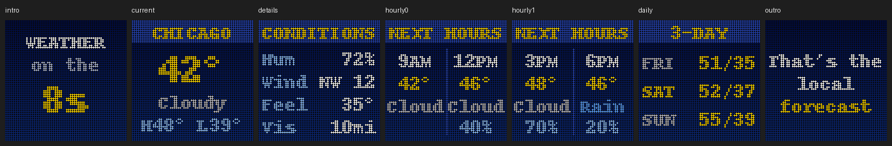

# Weather on the 8s

A nod to The Weather Channel's "Local on the 8s": every ten minutes — at **:08, :18,
:28, :38, :48 and :58** — the display takes over for about 46 seconds with your local
forecast, then goes back to whatever was showing (album art, the clock, a screensaver…).



| # | Screen | Shows | Time |
|---|---|---|---|
| 1 | Intro | "WEATHER on the 8s" | 3 s |
| 2 | Current | City, temperature, sky, today's high/low | 8 s |
| 3 | Conditions | Humidity, wind, feels-like, visibility | 8 s |
| 4–5 | Next hours | Four 3-hour periods: time, temperature, sky, chance of rain (when ≥ 20%) | 8 s each |
| 6 | 3-day | High/low for the next three days, coloured by the sky | 8 s |
| 7 | Outro | "That's the local forecast" | 3 s |

Times are in the forecast location's own timezone. Screens without data (e.g. no
forecast) are skipped.

## Turning it on

Admin panel → **Weather** → **Weather on the 8s** → *Enabled*. It needs an
[OpenWeatherMap](https://openweathermap.org/api) API key (the free tier is fine). If
you've already set one up for the Weather mode, leave the Weather on the 8s key, location
and units blank and it uses those.

Or in `config.json`:

```json
"weather_on_8s": {
  "enabled": true,
  "api_key": "",
  "location": "",
  "units": "",
  "display_duration": 60
}
```

| Key | Meaning |
|---|---|
| `enabled` | On/off |
| `api_key`, `location`, `units` | Blank = use the `weather` section's values. Location is `City,State,Country` (e.g. `Chicago,IL,US`); units `imperial` or `metric` |
| `display_duration` | Maximum seconds to show (the full sequence is ~46 s) |

## How it behaves

- **Reliable start:** it starts any time during the first 45 seconds of a :x8 minute, once
  per slot — even if the display was busy with another mode right at :x8:00.
- **Fresh data:** weather is fetched a minute ahead (:x7:30) and reused for up to 10
  minutes, so the sequence starts instantly.
- **No made-up numbers:** if the weather service can't be reached, it reuses the last
  forecast if it's under 3 hours old, otherwise it skips that slot.
- **Gets out of the way:** the test pattern and mode switches still work; when the
  sequence ends, the previous mode redraws immediately.

## Troubleshooting

| Problem | Fix |
|---|---|
| Never appears | Check it's enabled and an API key is set (here or under Weather). The log says `Weather on the 8s skipped: no recent weather data` if fetching fails |
| Wrong city | Use `City,State,Country`, e.g. `Portland,OR,US` |
| Times look off | They're local to the forecast location, not the Pi's timezone |
